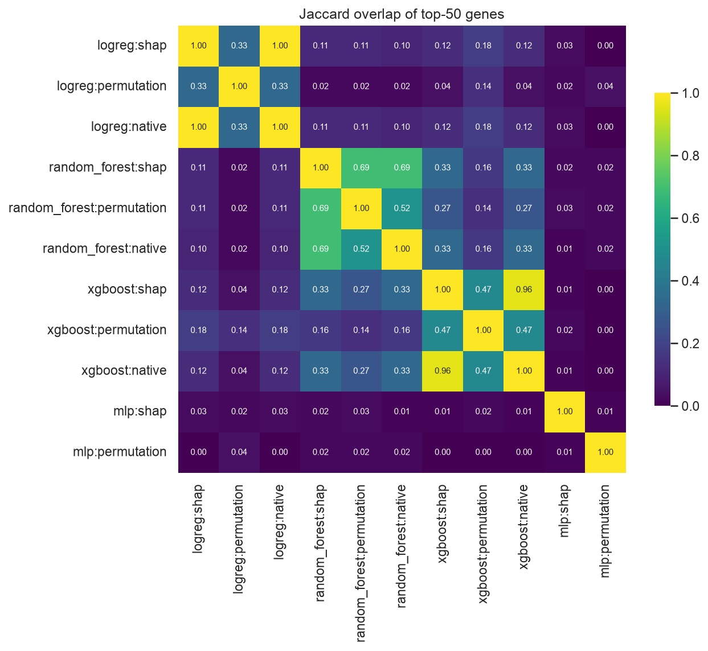
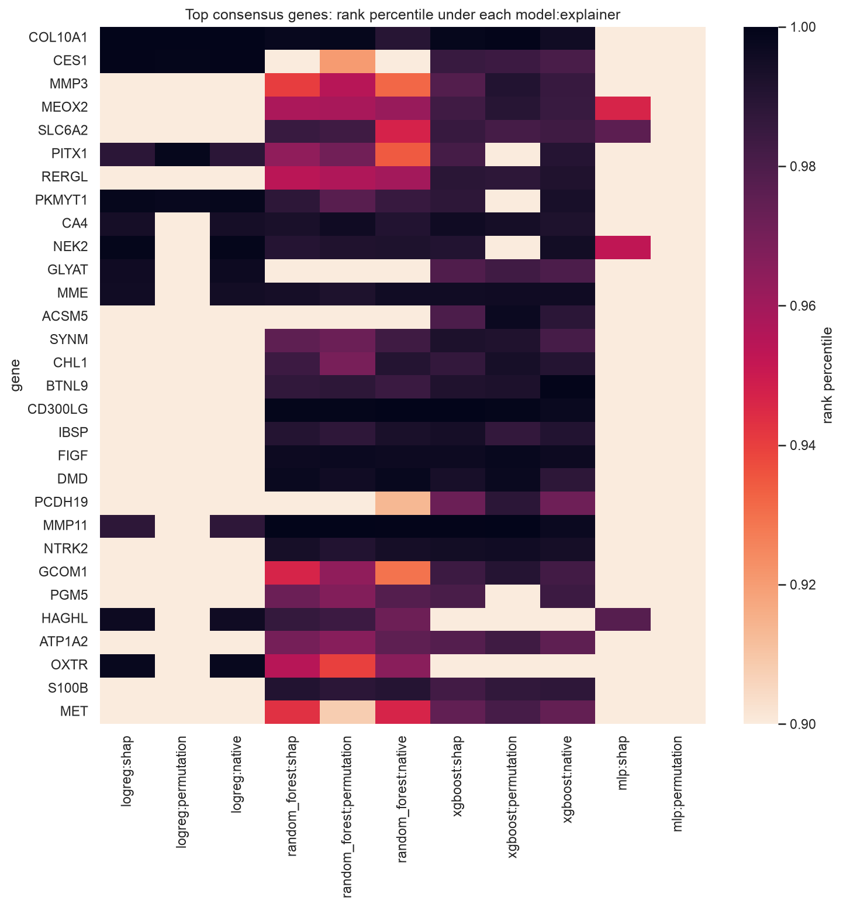
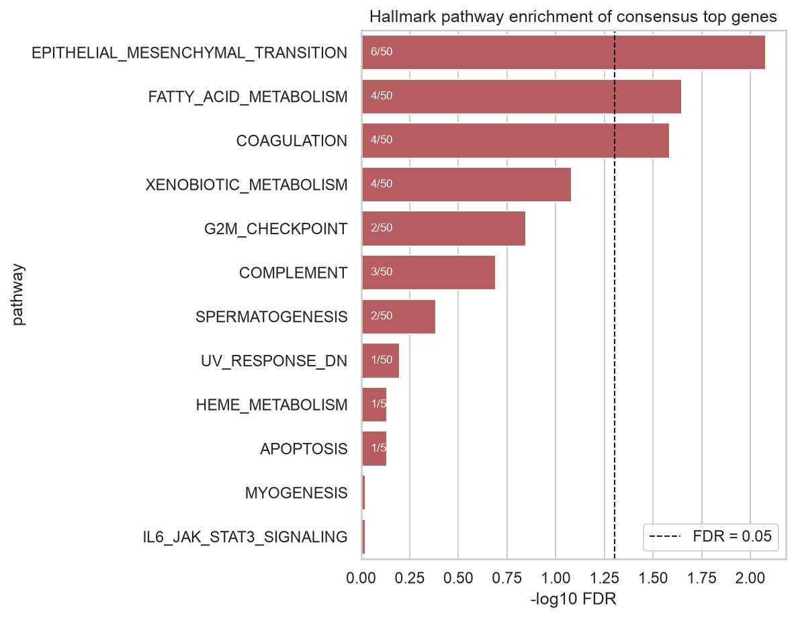
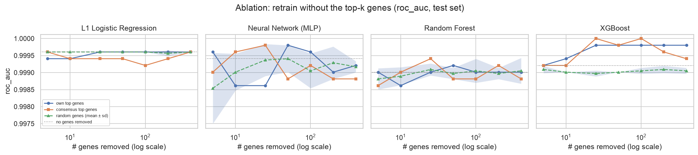
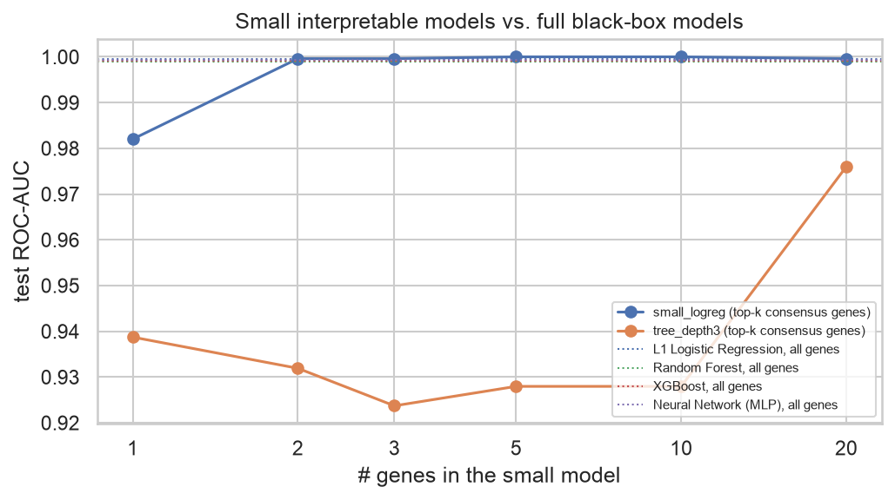
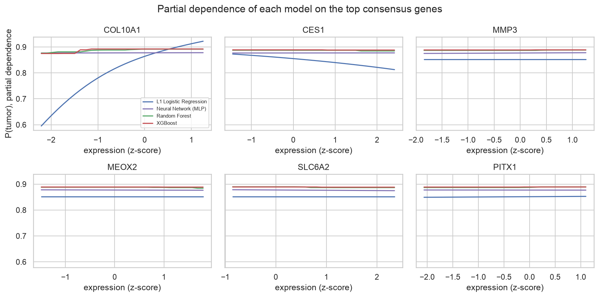

# Explainable AI for Cancer: do different models agree on *why* a tumor is malignant?

[](https://github.com/lolsripal/cancer-xai-compare/actions/workflows/tests.yml)

**Research question.** When a machine-learning model predicts that a breast tissue sample is a tumor, which genes actually drive that prediction, and do different models and explanation methods point to the same genes?

This project trains four models on TCGA breast cancer RNA-seq data and explains each one with three methods, then compares the explanations. The main output is that comparison. A small dashboard is included as a demo.

```
Model  ──►  Prediction  ──►  Explanation  ──►  Comparison across models & explainers
(4)         (tumor/normal)    (3 methods)        agreement · biology · ablation · sparsity
```

## TL;DR

| Question | Answer from this study |
|---|---|
| 1. Do different models identify the same genes? | **Mostly no.** Two models' top-50 gene lists share about 10% of genes (mean Jaccard 0.10). Two explainers applied to the *same* model share about 55%. The model you choose changes the explanation more than the explainer does. |
| 2. Are the top genes biologically plausible? | **Yes, but not in the way we expected.** All top-50 consensus genes differ strongly between tumor and normal tissue (\|log2FC\| ≈ 2–7). 35 of 50 are genes that are *lost* in tumors (fat, blood-vessel and nerve markers of normal breast), so the models largely detect "normal breast tissue is missing". The PAM50 subtype genes are **not** enriched (1/50, p = 0.43). |
| 3. Are they associated with known cancer pathways? | **Yes.** Hallmark EMT (FDR 0.008), fatty-acid metabolism (FDR 0.02) and coagulation (FDR 0.03) are enriched in the consensus list. Different models point to different biology: the random forest ranks proliferation genes (G2M checkpoint) highly, while XGBoost ranks fat-metabolism genes highly. |
| 4. Does removing the top genes change predictions? | **No, hardly at all.** Retraining without each model's 400 most important genes leaves ROC-AUC ≥ 0.998. The signal is spread across many redundant genes, so "important" does not mean "necessary". |
| 5. Can a small interpretable model match the black boxes? | **Yes.** A plain logistic regression on just 2 genes (COL10A1, CES1) reaches test ROC-AUC 0.9996, the same as XGBoost on 2,000 genes (0.9992). |

## Data

* **TCGA-BRCA** gene expression (Illumina HiSeq, log2(RSEM normalized count + 1)), from the [UCSC Xena](https://xenabrowser.net/) `TCGA.BRCA.sampleMap/HiSeqV2` matrix (20,530 genes).
* **Task:** primary tumor (`-01` barcode, n = 1,097) vs. solid tissue normal (`-11`, n = 114). Metastatic samples (`-06`) are excluded.
* **Patient-grouped splits.** Many normals have a matched tumor from the same patient. All splits are grouped by patient (stratified, 64% train / 16% validation / 20% test) so no person appears in two splits.
* **Feature selection on training data only:** genes with mean expression ≥ 1, then the 2,000 most variable. These are z-scored using training-set statistics.

| split | samples | tumor | normal | role |
|---|---|---|---|---|
| train | 774 | 701 | 73 | fit the models |
| validation | 194 | 176 | 18 | compute every explanation and gene ranking |
| test | 243 | 220 | 23 | final metrics, ablation, sparse models |

Gene rankings come only from the validation split and are scored only on the untouched test split, so feature selection by explanation never leaks into the reported numbers.

## Methods

**Models.** L1-regularised logistic regression · random forest (300 trees) · XGBoost (300 trees, depth 4) · multilayer perceptron (64-32). All use class-balancing weights except the MLP. See [`src/cxai/models.py`](src/cxai/models.py).

**Explanation methods.** See [`src/cxai/explain.py`](src/cxai/explain.py).

| method | logistic reg. | random forest | XGBoost | MLP |
|---|---|---|---|---|
| SHAP (mean \|value\|) | LinearSHAP | TreeSHAP | TreeSHAP | model-agnostic permutation SHAP |
| permutation importance (Δ log-loss) | ✓ | ✓ | ✓ | ✓ |
| native importance | \|coefficient\| | impurity decrease | gain | – |
| partial dependence | top 6 consensus genes, all models | | | |

**Comparisons.** See [`src/cxai/compare.py`](src/cxai/compare.py), [`biology.py`](src/cxai/biology.py), [`ablation.py`](src/cxai/ablation.py) and [`sparse.py`](src/cxai/sparse.py).
* *Agreement:* Jaccard overlap of top-50 lists, and Spearman correlation of ranks on the union of all top-50 lists.
* *Consensus ranking:* each gene's rank percentile, averaged over all 11 model × explainer combinations.
* *Biology:* hypergeometric over-representation (BH-FDR) against [MSigDB Hallmark](https://www.gsea-msigdb.org/gsea/msigdb/human/genesets.jsp?collection=H) gene sets and the PAM50 genes ([Parker et al., 2009](https://doi.org/10.1200/JCO.2008.18.1370)). The background is the 2,000 modeled genes.
* *Ablation:* retrain each model without its own top-k SHAP genes, or without the consensus top-k genes, for k = 5…400. The baseline is removing k random genes (5 repeats).
* *Sparse models:* a logistic regression and a depth-3 decision tree trained on only the top-k consensus genes.

## Results

All numbers below come from `results/` and are regenerated by `python -m cxai.pipeline`.

### Every model is near-perfect, so accuracy can't tell them apart

| model | ROC-AUC | PR-AUC (normal class) | balanced acc. | MCC |
|---|---|---|---|---|
| L1 logistic regression | 0.9996 | 0.9963 | 0.9977 | 0.977 |
| Random forest | 0.9990 | 0.9901 | 0.9977 | 0.977 |
| XGBoost | 0.9992 | 0.9923 | 0.9977 | 0.977 |
| MLP | 0.9994 | 0.9943 | 0.9955 | 0.955 |

Telling tumor from normal breast tissue is an easy task for gene-expression models. That is what makes the next result interesting: **four equally accurate models give very different reasons for their predictions.**

### Q1: Models disagree, explainers mostly agree



| comparison type | mean Jaccard@50 | mean Spearman (union of top-50) |
|---|---|---|
| same model, different explainer | **0.55** | 0.43 |
| same explainer, different model | 0.10 | 0.03 |
| different model and explainer | 0.10 | 0.01 |

* For the tree models, explainers broadly agree: XGBoost SHAP vs. gain gives 0.96, and random forest SHAP vs. permutation gives 0.69.
* The two tree ensembles share about a third of their top genes (0.33). Logistic regression shares about 10% with each of them, and the MLP shares almost none.
* For a linear model on standardized features, SHAP and |coefficient| give identical rankings (Jaccard 1.0), as theory predicts.
* The MLP's two explanations disagree with each other as well (0.01). Its SHAP values come from only 40 samples with a model-agnostic estimator, and permutation importance is noisy when many genes carry redundant information. Treat its rankings as the least reliable.



### Q2: Biologically plausible, but they mostly mark tissue composition

Top consensus genes ([full table](results/consensus_genes.csv)):

| rank | gene | log2FC tumor vs. normal | Hallmark sets |
|---|---|---|---|
| 1 | **COL10A1** | +6.9 | – |
| 2 | **CES1** | −4.2 | xenobiotic metabolism |
| 3 | MMP3 | +2.4 | EMT, coagulation |
| 4 | MEOX2 | −3.4 | – |
| 5 | SLC6A2 | −3.2 | – |
| 6 | PITX1 | +4.3 | – |
| 7 | RERGL | −4.4 | – |
| 8 | PKMYT1 | +4.4 | – |
| 9 | CA4 | −6.6 | fatty-acid metabolism |
| 10 | NEK2 | +4.5 | G2M checkpoint, mitotic spindle |

* **Genes up in tumors** include extracellular-matrix remodelling genes (COL10A1, MMP3, MMP11) and cell-cycle kinases (PKMYT1, NEK2). These fit the dense stroma and fast proliferation seen in breast tumors.
* **35 of the top 50 genes are down in tumors** (e.g. CA4, CD300LG, FIGF/VEGFD, GLYAT, ATP1A2). Normal breast tissue is mostly fat and blood vessels, so to a large extent the models learn that normal tissue is absent rather than detecting specific cancer drivers.
* **PAM50 is not enriched** (1 of 50 genes, MMP11; expected 0.55; p = 0.43). PAM50 was built to separate breast cancer *subtypes* from one another, not tumors from normal tissue. "Known cancer gene" lists only help as a check when they were built for the same question the model is answering.

### Q3: Pathway enrichment



Significant at FDR < 0.05 for the consensus top-50 list: **epithelial–mesenchymal transition** (6 genes, 6.5× enrichment), **fatty-acid metabolism** (4 genes, 8×), **coagulation** (4 genes, 7×).

Per-model rankings point to different pathways ([table](results/pathway_enrichment_by_ranking.csv)). All three random forest rankings are enriched for **G2M checkpoint** (proliferation). All three XGBoost rankings are enriched for **fatty-acid metabolism** (adipose tissue). Logistic regression and the MLP give no significant pathways. So a researcher who explained only one model would come away with a different biological story depending on which model they picked.

### Q4: Removing the "most important" genes barely matters



Retraining each model without its top 5, 10, … 400 genes keeps ROC-AUC between 0.998 and 1.000, the same range as removing random genes. Log-loss rises slightly for the random forest (0.032 → 0.059 after removing its top 400 genes, vs. 0.034 for 400 random genes), which shows the removed genes did carry some confidence. The tumor/normal signal is spread across hundreds of correlated genes: when one is removed, others take its place. This also explains why the models disagree in Q1: there are many equally good gene sets to choose from.

### Q5: A 2-gene model is as good as the black boxes



| model | genes | test ROC-AUC | balanced acc. |
|---|---|---|---|
| logistic regression | 1 (COL10A1) | 0.982 | 0.958 |
| logistic regression | **2 (COL10A1, CES1)** | **0.9996** | 0.976 |
| logistic regression | 5 | 1.000 | 0.998 |
| depth-3 tree | 3 | 0.924 | 0.926 |
| depth-3 tree | 20 | 0.976 | 0.976 |
| XGBoost (reference) | 2,000 | 0.9992 | 0.998 |

A linear model on two genes matches every black-box model. Shallow trees do worse, because cutting each gene at a single threshold loses information that a smooth linear boundary keeps. The tree's rules, with thresholds in log2 expression units, are in [`results/tree_rules_top3.txt`](results/tree_rules_top3.txt).

### Partial dependence



## Conclusions

1. **An explanation describes one model, not the biology itself.** Models that are equally accurate rank very different genes as most important. The choice of model matters far more than the choice of explainer.
2. **Redundancy is the underlying cause.** Hundreds of genes separate tumor from normal tissue, so each model can pick a different subset. Ablation confirms that no small gene set is necessary.
3. **Consensus across models is more trustworthy than any single explanation.** Genes that rank high for every model and method (COL10A1, CES1, CA4, MMP11, CD300LG) are strongly differentially expressed and fit stromal and adipose tissue biology.
4. **For this task, simple models are enough.** A transparent 2-gene logistic regression performs as well as XGBoost, so a black-box model buys no accuracy here.

**Limitations.** Tumor vs. normal is an easy task. Harder tasks, such as subtype or survival prediction, would test explanations harder. Normal samples are few (114) and are tumor-adjacent tissue, not healthy breast. The differences partly reflect how much fat and stroma each sample contains, not only what the cancer cells are doing. Feature importance shows association, not causation. Results come from one cohort, one random seed and one split. Gene symbols in the 2016 Xena matrix are older than MSigDB 2024, so a few genes may fail to match.

## Dashboard (demo)

`app/dashboard.py` is a Streamlit app. You choose a held-out example sample or upload a CSV of gene-expression values and see the **prediction → confidence → top contributing genes (SHAP) → Hallmark pathway interpretation**, along with whether all four models agree.

```bash
streamlit run app/dashboard.py
```

*Research demo only. Not for diagnosis or any clinical decision.*

## Reproduce

```bash
git clone https://github.com/lolsripal/cancer-xai-compare.git
cd cancer-xai-compare
python -m venv .venv && source .venv/bin/activate
pip install -r requirements.txt && pip install -e .
# macOS only: XGBoost needs OpenMP ->  brew install libomp

python -m cxai.pipeline          # full run: downloads ~64 MB, ~6 min on a laptop
python -m cxai.pipeline --demo   # synthetic data, ~15 s
pytest -q                        # tests run on synthetic data, no download
streamlit run app/dashboard.py
```

Settings (number of genes, top-k, ablation sizes, etc.) are in [`config.yaml`](config.yaml).

## Repository layout

```
src/cxai/        data · models · explain · compare · biology · ablation · sparse · plots · pipeline
app/             Streamlit dashboard
resources/       MSigDB Hallmark gene sets (CC BY 4.0) · PAM50 gene list
results/         tables (CSV), figures (PNG), summary.json produced by the pipeline
tests/           pytest suite: split leakage, enrichment math, an end-to-end run on planted synthetic signal
```

## Data & licences

TCGA data: The Cancer Genome Atlas Research Network, accessed via UCSC Xena (open access). Hallmark gene sets: Liberzon et al., *Cell Systems* 2015, MSigDB (CC BY 4.0). Code: MIT licence.
