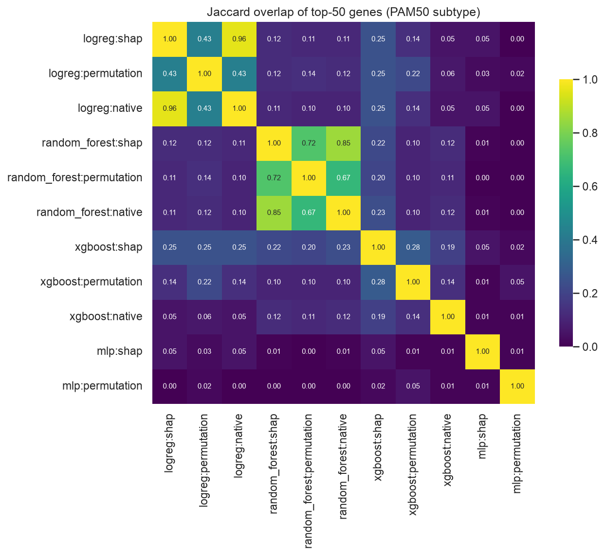
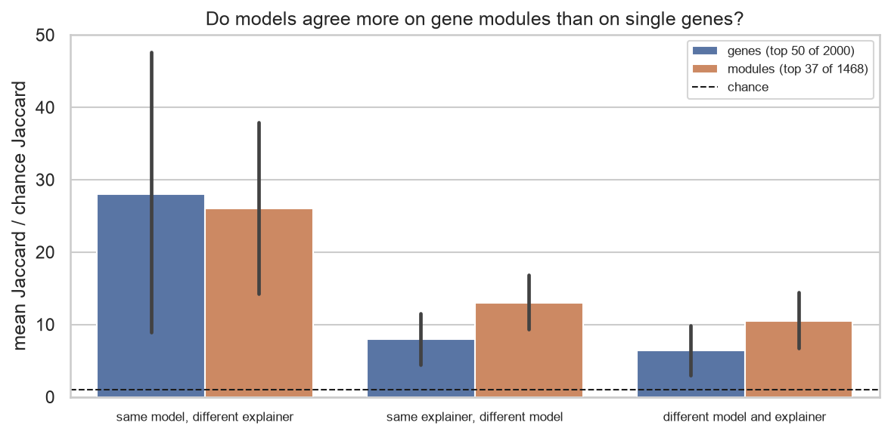
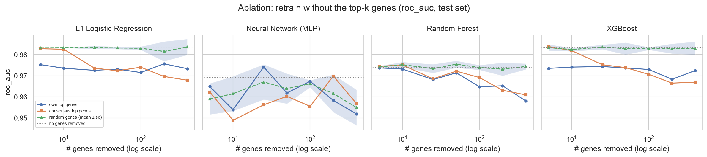
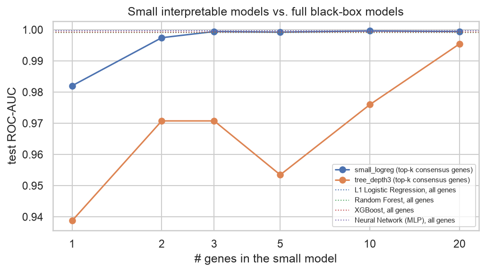
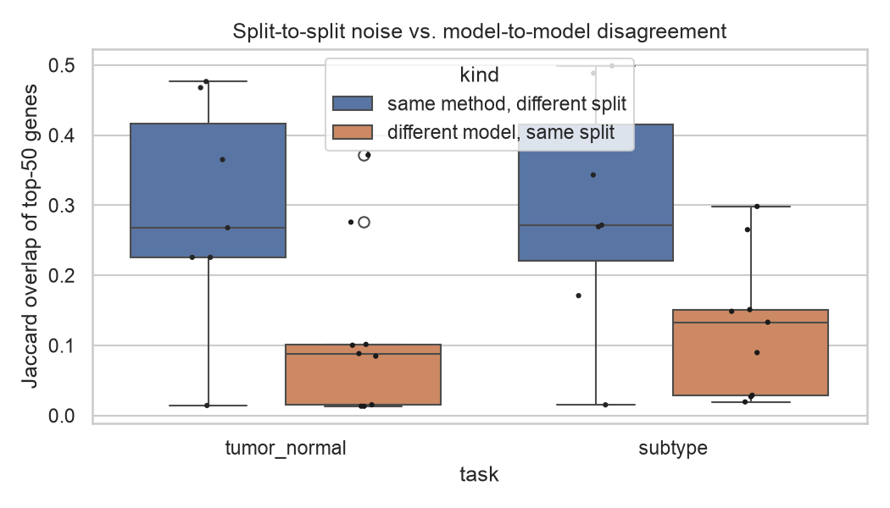
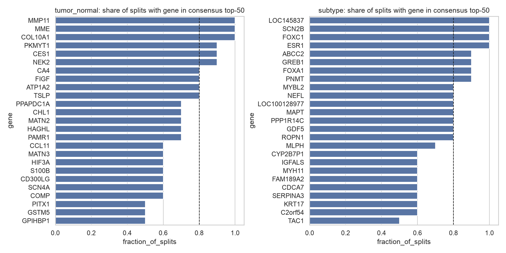

# Explainable AI for Cancer: do different models agree on *why*?

[](https://github.com/lolsripal/cancer-xai-compare/actions/workflows/tests.yml)
[](https://lolsripal.github.io/cancer-xai-compare/)

**📊 Interactive results: [lolsripal.github.io/cancer-xai-compare](https://lolsripal.github.io/cancer-xai-compare/)**

**Research question.** When a machine-learning model predicts a breast cancer outcome from gene expression, which genes actually drive the prediction, and do different models and explanation methods agree?

The project trains four models (L1 logistic regression, random forest, XGBoost and a neural network) on TCGA breast cancer RNA-seq. Each model is explained three ways: SHAP, permutation importance and the model's built-in importance. The comparison is run on two tasks:

| task | classes | why it's here |
|---|---|---|
| **Tumor vs. normal** | 1,097 primary tumors / 114 normal tissue samples | the "is this malignant?" question; easy for every model |
| **PAM50 subtype** | LumA 421 / LumB 192 / Her2 67 / Basal 141 | harder, and a **positive control**: the labels were defined from the 50 PAM50 genes, so we know which genes a faithful explanation should find |

```
Model (4) ──► Prediction ──► Explanation (3) ──► Comparison
                                                  agreement · modules · biology · ablation
                                                  small models · stability (10 splits) · sanity checks
```

## Key findings

| | Tumor vs. normal | PAM50 subtype |
|---|---|---|
| Test performance | ROC-AUC 0.999–0.9996 for all four models | macro ROC-AUC 0.97–0.98, balanced accuracy 0.86–0.89 |
| **Q1** Do models agree on genes? | **No.** Different models share 0.09 of their top-50 genes (6.7× chance); two explainers on the *same* model share 0.48 | **No.** 0.10 (7.8× chance) vs. 0.47 |
| Do they agree on gene *modules*? | Somewhat more: 5.6× → 9.6× chance | More: 8.0× → 13.0× chance. The FOXA1 and PGR estrogen modules are in all 8 top-module lists |
| **Q2** Biologically plausible? | Yes, but mostly **tissue composition**: 34/50 top genes are *lost* in tumors (fat and blood-vessel genes) | **Positive control passed by tree models:** random forest / XGBoost recover 11–12 of the 20 PAM50 genes; the neural network recovers **0** |
| **Q3** Known pathways? | None at FDR < 0.05 for the consensus list (random forest alone: G2M checkpoint) | **Estrogen response** for the consensus list *and* for logistic regression, random forest and XGBoost separately |
| **Q4** Does removing top genes matter? | **No.** Removing 400 top genes, the 120-gene top module, or all PAM50 genes leaves ROC-AUC ≥ 0.998 | **A little.** Top 50 genes: −0.01 AUC. Top 20 modules: random-forest balanced accuracy 0.87 → 0.80. All PAM50 genes: 0.87 → 0.83 |
| **Q5** Small interpretable model? | **Yes.** A 2-gene logistic regression reaches AUC 0.997; 5 genes match the full models | **Nearly.** 20 genes reach 0.87 balanced accuracy (best full model 0.89) |
| Sanity check (shuffled labels) | Linear and tree explanations fall to chance overlap (pass). **The neural network keeps 18%** (≈14× chance) and fails | Same pattern: the neural network keeps 9% (≈7× chance) |

### Stability across 10 patient-grouped splits

| | Tumor vs. normal | PAM50 subtype |
|---|---|---|
| Test ROC-AUC, mean ± sd | 0.998–0.9996 (sd ≤ 0.002) | 0.970–0.985 (sd ≤ 0.008) |
| Same method, different split (top-50 Jaccard) | 0.29 on average. Random forest is the most stable (0.48); **neural-network SHAP is at chance (0.014)** | 0.29 on average. Random forest 0.49–0.50; neural-network SHAP 0.015 |
| Different models, same split | 0.12 | 0.13 |
| **Stable core** (consensus top-50 in ≥ 80% of splits) | 10 genes: COL10A1, MMP11, MME, PKMYT1, CES1, NEK2, CA4, FIGF, ATP1A2, TSLP | 15 genes, including PAM50's **ESR1, FOXA1, FOXC1, MAPT, MYBL2** and the estrogen target GREB1 |

A single run's top-50 list is noisy: retrain on new patients and more than half of it changes. Disagreement between models is still larger than this noise. Genes that survive across splits *and* models form a far more trustworthy shortlist than any single explanation.

**Bottom line.** Explanations from equally accurate models describe *the model*, not the biology. Single-gene rankings disagree because many genes carry the same signal (the ablations show it). Agreement improves at the level of co-expression modules and pathways, which is where biological conclusions should be drawn. On the positive-control task, tree-model SHAP recovers the known genes, while the neural network's explanations both miss them and fail the sanity check.

## Upgrades in this version

1. **Harder task with a known answer.** PAM50 subtype classification turns "are the genes plausible?" into a measurable recovery test.
2. **Gene-module explanations.** Genes are clustered into co-expression modules (training data only). Modules are explained by summed SHAP values (valid because SHAP is additive) and by grouped permutation, then compared and ablated.
3. **Stability across 10 patient-grouped splits.** Separates a model's own split-to-split noise from real disagreement between models, and yields a "stable core" gene list.
4. **Sanity checks.** An exact chance baseline for every agreement number, and the label-randomization test of [Adebayo et al. (NeurIPS 2018)](https://arxiv.org/abs/1810.03292).
5. **An interactive results website** (GitHub Pages), rebuilt automatically from `results/` on every push.

## Data and leakage control

* **TCGA-BRCA** RNA-seq from [UCSC Xena](https://xenabrowser.net/) (`TCGA.BRCA.sampleMap/HiSeqV2`, log2(RSEM + 1), 20,530 genes). Subtype labels come from the `PAM50Call_RNAseq` column of the Xena clinical matrix (Normal-like excluded).
* **Patient-grouped, stratified splits:** 64% train, 16% validation, 20% test. Many normals have a matched tumor from the same patient, so no patient ever appears in two splits.
* The **2,000 most variable genes** are selected, and z-scored, on the **training split only**.
* All explanations and gene rankings are computed on **validation**. Every reported metric (performance, ablation, small models) is measured on the untouched **test** split.

## Methods (code map)

| step | what | code |
|---|---|---|
| models | L1 logistic regression, random forest (300 trees), XGBoost (300 trees, depth 4), MLP (64-32); class-balanced sample weights | [`models.py`](src/cxai/models.py) |
| explain | SHAP (Linear / Tree / permutation-SHAP for the MLP), permutation importance (Δ log-loss), native importance, partial dependence | [`explain.py`](src/cxai/explain.py) |
| agreement | Jaccard of top-50 lists, Spearman correlation on the union of top lists, consensus rank, exact chance baseline | [`compare.py`](src/cxai/compare.py), [`sanity.py`](src/cxai/sanity.py) |
| modules | average-linkage clustering on 1 − \|r\| (cut at \|r\| ≥ 0.6); module SHAP = \|Σ SHAP\|; grouped permutation; module ablation | [`modules.py`](src/cxai/modules.py) |
| biology | hypergeometric over-representation with BH-FDR against MSigDB Hallmark and PAM50 ([Parker et al., 2009](https://doi.org/10.1200/JCO.2008.18.1370)) | [`biology.py`](src/cxai/biology.py) |
| ablation | retrain without top-k genes, without modules, or without all PAM50 genes, vs. the same number of random genes | [`ablation.py`](src/cxai/ablation.py) |
| small models | logistic regression and depth-3 tree on the top-k consensus genes | [`sparse.py`](src/cxai/sparse.py) |
| stability | the whole train-and-explain loop on 10 splits | [`stability.py`](src/cxai/stability.py) |
| sanity | label randomization | [`sanity.py`](src/cxai/sanity.py) |
| site | static results website | [`site.py`](src/cxai/site.py) |

## Selected figures

The interactive versions are on the [results site](https://lolsripal.github.io/cancer-xai-compare/). All figures are in [`results/`](results/).

| Gene-level agreement (subtype) | Genes vs. modules (subtype) |
|---|---|
|  |  |
| **Ablation (subtype)** | **Small vs. full models (tumor vs. normal)** |
|  |  |

| Split-to-split noise vs. model disagreement | Stable core genes |
|---|---|
|  |  |

## Limitations

* Tumor vs. normal is easy, and its normal samples are tumor-adjacent tissue rather than healthy breast. Part of the signal is fat and stroma content.
* PAM50 labels are computed from PAM50 gene expression, so the subtype task tests whether explainers recover a known rule, not whether they discover new biology. Only 20–22 of the 50 PAM50 genes survive the variance filter.
* Feature importance measures association with the prediction, not causation.
* Everything comes from one cohort (TCGA). Validating on an external cohort such as METABRIC is the natural next step.
* MLP SHAP values come from few samples with a model-agnostic estimator, and they fail the sanity check. Treat MLP rankings as the least reliable.
* Gene symbols in the 2016 Xena matrix are older than MSigDB 2024, so a few genes may not match a pathway.

## Dashboard

`app/dashboard.py` is a Streamlit demo for either task. You choose a held-out sample or upload a CSV of gene expression and see the **prediction → confidence → top contributing genes (SHAP) → Hallmark pathway interpretation**, along with whether all four models agree.

```bash
streamlit run app/dashboard.py
```

*Research demo only. Not for diagnosis or any clinical decision.*

## Reproduce

```bash
git clone https://github.com/lolsripal/cancer-xai-compare.git
cd cancer-xai-compare
python -m venv .venv && source .venv/bin/activate
pip install -r requirements.txt && pip install -e .
# macOS only: XGBoost needs OpenMP ->  brew install libomp

python -m cxai.pipeline --task all   # both tasks; downloads ~65 MB once (~50 min on a laptop)
python -m cxai.stability             # 10-split stability study (~12 min)
python -m cxai.site                  # rebuild the results website into _site/
python -m cxai.pipeline --task all --demo && python -m cxai.stability --demo   # synthetic data, ~1 min
pytest -q                            # 15 tests on synthetic data, no download
```

All settings are in [`config.yaml`](config.yaml).

## Publishing the results site

The [`pages` workflow](.github/workflows/pages.yml) builds the site from the committed `results/` folder on every push to `main`. One-time setup: **Settings → Pages → Build and deployment → Source: GitHub Actions**.

## Repository layout

```
src/cxai/    data · models · explain · compare · modules · biology · ablation · sparse
             sanity · stability · plots · pipeline · site
app/         Streamlit dashboard
resources/   MSigDB Hallmark gene sets (CC BY 4.0) · PAM50 gene list
results/     tumor_normal/ · subtype/ · stability/: CSV tables, PNG figures, summary.json
tests/       pytest: split leakage, multiclass, enrichment math, modules, chance baseline,
             end-to-end runs that recover planted signals, site build
```

## Data & licences

TCGA data: The Cancer Genome Atlas Research Network, via UCSC Xena (open access). Hallmark gene sets: Liberzon et al., *Cell Systems* 2015, MSigDB (CC BY 4.0). Code: MIT licence.
